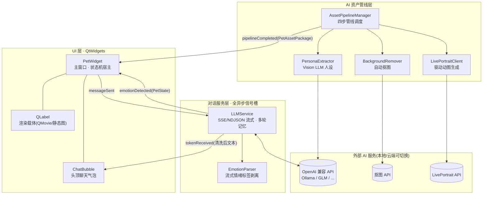
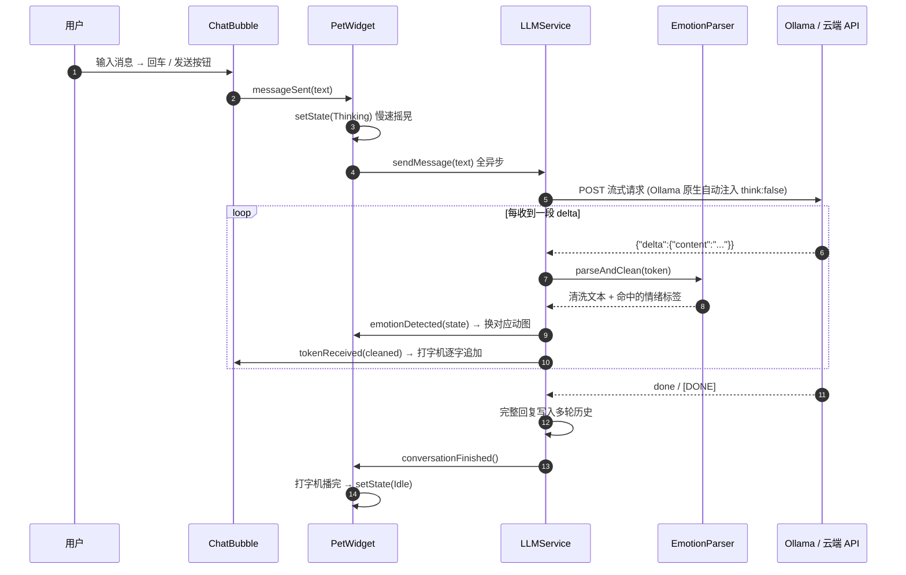
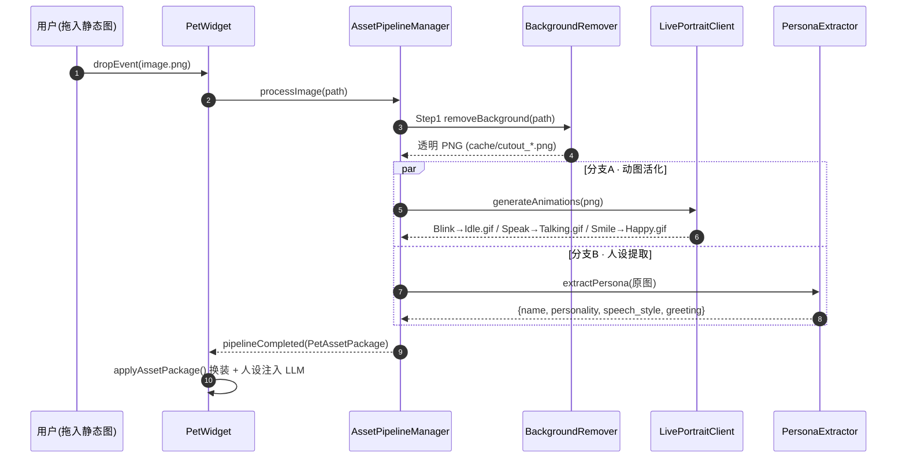
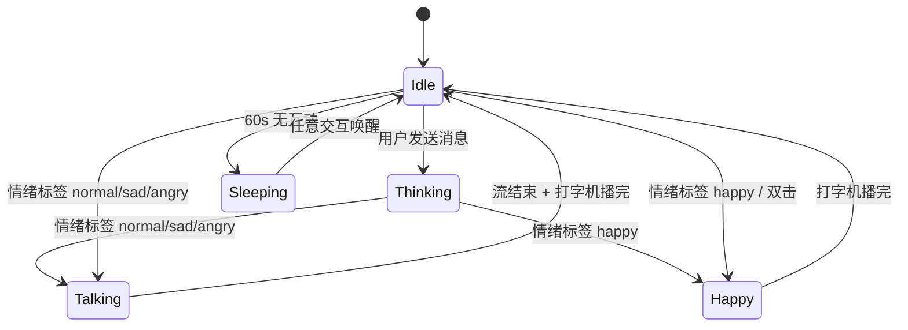

# AniDesk-Qt 🐾

**AI 动态桌面宠物** —— 一只住在你桌面上的、有形象的、能聊天的电子宠物。

基于 **Qt 6 / C++17** 构建：拖入一张图片，AI 自动为你生成透明形象、驱动动图与角色人设；通过本地或云端大模型流式对话，回复中的情绪标签实时驱动宠物的动作与表情。


---

## ✨ 当前特性

| 阶段 | 特性 | 状态 |
|---|---|---|
| 第一步 · 动态渲染引擎 | 无边框透明置顶窗口、平滑拖拽、呼吸悬浮微动、双击/右键气泡、打字机效果 | ✅ |
| 第一步 · 动画状态机 | `Idle / Talking / Thinking / Happy / Sleeping` 五状态，按状态切换片源与播放速率 | ✅ |
| 第二步 · AI 资产管线 | 拖图 → 自动抠图 → 并行生成动图与提取人设 → 打包换装，全链路优雅降级 | ✅ |
| 第三步 · 流式对话引擎 | SSE/NDJSON 双协议流式解析、多轮记忆、情绪标签实时驱动状态机 | ✅ |
| 对话触发动作系统 | 聊天命中动作关键词（拔剑/跳跃/鞠躬…）即播放全身动作包络动画 | ✅ |
| 内置形象 | 五段带 Alpha 通道的状态 GIF（Pillow 脚本生成，qrc 内置） | ✅ |
| 兜底渲染 | 完全没有素材时，程序化绘制一只会呼吸、会眨眼的“小团子” | ✅ |

---

## 🏗️ 技术路线总览

项目按三个阶段递进，每一步都可以独立运行，逐步叠加 AI 能力：

```
第一步：让宠物"活"在桌面上          第二步：让宠物"像"任意角色           第三步：让宠物"懂"你
┌────────────────────────┐      ┌────────────────────────┐      ┌────────────────────────┐
│ 渲染引擎 + 动画状态机    │  →   │ AI 图像活化 + 人设生成   │  →   │ LLM 流式对话 + 情绪驱动  │
│ 无边框窗口 / QMovie     │      │ 抠图 → 动图 → 人设       │      │ SSE 流式 / 情绪标签      │
│ 拖拽 / 气泡 / 呼吸      │      │ 管线调度 / 优雅降级      │      │ 双协议 / 多轮记忆        │
└────────────────────────┘      └────────────────────────┘      └────────────────────────┘
```

### 分层架构



### 核心数据流 ①：流式对话与情绪驱动



### 核心数据流 ②：AI 资产生成管线



### 宠物动画状态机



> 情绪 → 状态映射：`happy→Happy`、`thinking→Thinking`、`normal/sad/angry→Talking`（sad/angry 专属动图在路线图中）。

---

## 🧩 模块与关键技术实现

| 模块 | 文件 | 关键技术 |
|---|---|---|
| 宠物主窗口 | `src/PetWidget.h/.cpp` | 无边框透明窗口、拖拽、状态机、片源解析、程序化兜底绘制 |
| 聊天气泡 | `src/ChatBubble.h/.cpp` | QSS 圆角半透明卡片、QGraphicsDropShadowEffect、打字机队列、忙碌保持 |
| 管线调度 | `src/AssetPipelineManager.h/.cpp` | 四步流程、并行分支、进度上报、优雅降级 |
| 抠图客户端 | `src/BackgroundRemover.h/.cpp` | QNetworkAccessManager、multipart 云端协议、PNG/base64/url 三种响应自适应 |
| 动图客户端 | `src/LivePortraitClient.h/.cpp` | 三模板并行请求、GIF 魔数校验、缓存落盘 |
| 人设提取 | `src/PersonaExtractor.h/.cpp` | Vision LLM 多模态请求、JSON 平衡扫描解析、System Prompt 组装 |
| 对话服务 | `src/LLMService.h/.cpp` | 双协议流式解析、行缓冲、多轮记忆、reply 生命周期安全收尾 |
| 情绪解析 | `src/EmotionParser.h/.cpp` | 正则匹配 + 半截标签滞留缓冲，流式零泄漏 |

几个值得展开的设计决策：

### 1. 呼吸悬浮：QPropertyAnimation 驱动 `pos` 属性

对 `PetWidget::pos` 做无限循环动画，关键帧 `锚点 → 锚点-(0,5px) → 锚点`，缓动 `InOutQuad` 得到正弦式起伏。拖拽时**暂停**动画避免与 `move()` 争抢属性，松手后以落点为新锚点重建关键帧重启，保证循环首尾无缝。

### 2. 双通道渲染 + 程序化兜底

片源解析优先级：**形象包（AI 管线产物）> 用户拖入素材 > 内置 qrc 状态 GIF**； Thinking/Sleeping 沿用内置素材。任何片源都不可用时，`paintEvent` 用 QPainter 程序化绘制一只小团子（呼吸、眨眼、腮红、按状态变脸），保证项目**零素材也能跑起来**。

### 3. AI 管线的优雅降级

管线的每一步都可能因服务未部署而失败，全部走降级路径而非中断：

| 失败环节 | 降级行为 |
|---|---|
| 抠图服务不可用 | 直接用原图继续（视为已透明） |
| 动图生成失败 | 对应状态回落为透明 PNG 静态形象（QMovie 同样支持单帧） |
| 人设提取失败 | 用文件名起名 + 默认人设 |

因此**只装一个 Ollama 文本模型，拖图换装全流程也是通的**。

### 4. LLM 双协议：为什么不是一条 /v1 走到底

对接 `qwen3.5` 这类**思考型模型**时发现：Ollama 的 OpenAI 兼容端点 `/v1/chat/completions` 会**忽略 `think:false` 字段**，思考阶段实测长达 **428 秒**；而原生 `/api/chat` 注入 `think:false` 后 **6 秒**即出正文。因此 `LLMService` 实现了双协议：

| | OpenAI 兼容（SSE） | Ollama 原生（NDJSON） |
|---|---|---|
| 端点 | `{base}/chat/completions` | `{base}/api/chat` |
| 数据格式 | `data: {...}` / `data: [DONE]` | 每行一个 JSON，`done:true` 结束 |
| 增量字段 | `choices[0].delta.content` | `message.content` |
| 使用条件 | 云端 API / 不关思考 | 检测到 Ollama 地址且开启"禁思考"时自动切换 |

思考型模型的思考增量（`reasoning`）被自然跳过——只读取 `content` 字段。

### 5. 流式情绪标签解析：半截标签滞留缓冲

模型输出的 `[EMOTION: happy]` 可能被切进任意两个 token 之间（`[EMO` + `TION: ...`）。解析器维护一个滞留缓冲：每轮先剥离所有完整标记并上报情绪，再检查尾部是否存在某个合法标签的**前缀**（大小写/空白归一化后比对），是则扣留等待下一个 token，否则放行；流结束时 `flush()` 取回滞留文本，保证内容零丢失。

### 6. 气泡生命周期：忙碌保持 + reply 安全收尾

- **忙碌保持**：等待 LLM 首 token（思考可能持续数十秒）或管线运行期间，气泡的 20s 无操作自动隐藏被暂停——否则自动关闭会顺手取消还没开始回复的流。
- **reply 生命周期**：`[DONE]` 到达时不能在 `readyRead` 派发栈内直接 `abort()/deleteLater()`（会与 `finished` 信号重入叠加，引发对已销毁对象的操作——曾实测段错误）。收尾统一走 `disposeReply()`：先 `disconnect(this)` 切断信号，再延迟到下一轮事件循环销毁；`m_finalized` 标志保证任何重入路径都只收尾一次、历史只入库一次。

---

## 📁 目录结构

```
AniDesk-Qt/
├── CMakeLists.txt               # Qt6 (Core/Gui/Widgets/Network) + AUTOMOC/AUTORCC
├── assets/
│   ├── pets.qrc                 # 内置形象资源（每个状态一段带 Alpha 的 GIF）
│   └── pets/*.gif
├── tools/
│   └── gen_pet_gifs.py          # Pillow 生成内置 GIF 素材的脚本
└── src/
    ├── main.cpp                 # 入口：右下角放置宠物
    ├── PetWidget.h/.cpp         # 主窗口 · 渲染 · 状态机 · AI 总装
    ├── ChatBubble.h/.cpp        # 头顶聊天气泡
    ├── AssetPipelineManager.h/.cpp  # AI 资产管线调度（第二步）
    ├── BackgroundRemover.h/.cpp     # 抠图客户端（第二步）
    ├── LivePortraitClient.h/.cpp    # 动图驱动客户端（第二步）
    ├── PersonaExtractor.h/.cpp      # Vision LLM 人设提取（第二步）
    ├── LLMService.h/.cpp        # LLM 流式对话服务（第三步）
    └── EmotionParser.h/.cpp     # 情绪标签解析器（第三步）
```

## 🔨 构建与运行

**环境要求**：Qt 6.5+（推荐 6.7.x，已在 6.7.3 MinGW 实测）、CMake 3.16+、支持 C++17 的编译器（MSVC 需 VS2019+，已自动加 `/utf-8`）。

```bash
# 1. 配置（Qt 不在系统路径时指定 CMAKE_PREFIX_PATH）
cmake -S . -B build -DCMAKE_PREFIX_PATH="C:/Qt/6.7.3/mingw_64"

# 2. 编译
cmake --build build

# 3. 运行（Windows/MinGW 需保证 Qt 的 bin 目录在 PATH 中，或用 windeployqt 部署 DLL）
./build/AniDesk-Qt.exe
#   windeployqt build/AniDesk-Qt.exe   # 发布时打包依赖
```

**对话功能需要一个大模型端点**，最快的路径是本地 Ollama：

```bash
ollama serve                          # 启动服务
ollama pull qwen3.5:0.8b              # 拉取模型（或换成任意你已有的模型）
```

> 没有模型也没关系：聊天会收到友好错误提示，拖图换装走降级路径，宠物本体照常运行。

## ⚙️ AI 服务配置

所有服务地址集中在 `PetWidget::setupAiServices()` 中，一行即可切换本地/云端：

```cpp
// 第三步：LLM 对话（OpenAI 兼容；本地 Ollama 留空 Key）
m_llm->setApiConfig("https://api.open.bigmodel.cn/api/paas/v4", "你的APIKey", "glm-4-flash");

// 第二步：三个子服务
m_pipeline->setBackgroundRemovalApi("http://127.0.0.1:8765/removebg", "");  // 或 remove.bg 官方端点+Key
m_pipeline->setLivePortraitApi("http://127.0.0.1:7890");
m_pipeline->setVisionApi("http://localhost:11434/v1", "", "qwen2.5vl:7b");  // 需多模态模型
```

| 服务 | 默认地址 | 模型默认值 | 产物 |
|---|---|---|---|
| LLM 对话 | `http://localhost:11434/v1` | `qwen3.5:0.8b` | 流式回复 + 情绪标签 |
| 抠图 | `http://127.0.0.1:8765/removebg` | — | `cache/cutout_*.png` |
| 动图 | `http://127.0.0.1:7890`（`POST /animate`） | blink/speak/smile 模板 | `cache/{Idle,Talking,Happy}.gif` |
| 人设 | `http://localhost:11434/v1` | `qwen2.5vl:7b`（多模态） | 角色 System Prompt |

## 🎮 交互指南

| 操作 | 效果 |
|---|---|
| 双击 / 右键宠物 | 弹出头顶气泡，打招呼 |
| 气泡输入 + 回车/发送 | 流式对话，情绪驱动动图 |
| 拖入 GIF/APNG | 直接换肤（动画形象） |
| 拖入 PNG/JPG 静态图 | 进入 AI 管线，生成专属形象与人设 |
| 聊天说"拔剑 / 跳一跳 / 鞠躬 / 点头 / 转个圈 / 冲 / 摇头" | 触发对应全身动作动画 |
| 左键按住拖动 | 移动宠物位置（气泡实时跟随） |
| Esc / 20s 无操作 | 关闭气泡（对话中会被忙碌保持阻止） |
| 60s 不理它 | 自动入睡（Sleeping 状态 + Zzz） |
| `Ctrl+Q` | 退出 |

## 🗺️ 路线图

- [x] **第一步**：Qt 动态渲染引擎与动画状态机（无边框窗口、拖放、QMovie、呼吸悬浮、气泡）
- [x] **第二步**：AI 图像活化与人设生成管线（抠图/动图/人设并行调度 + 优雅降级）
- [x] **第三步**：LLM 流式对话与情绪驱动引擎（双协议 SSE/NDJSON、多轮记忆、情绪标签状态机）
- [x] **第三步半**：对话触发动作系统（关键词 → 可编程动作包络：拔剑/跳跃/鞠躬/点头/转身/冲刺/摇头）+ 本地抠图服务参考实现（`services/rmbg_server.py`）+ 静态形象微动作
- [ ] **第四步（规划中）**
  - 本地抠图服务参考实现（RMBG-2.0 / MODNet + 内置 HTTP 包装，开箱即用）
  - LivePortrait 适配层：对接 ComfyUI 工作流队列（当前为轻量自定义 HTTP 契约）
  - `sad / angry` 专属动图与情绪细化映射
  - 静态图的兜底"伪动态"处理（眨眼/呼吸贴片合成 GIF）
- [ ] **第五步（展望）**
  - TTS 语音合成与口型对齐、ASR 语音输入
  - 长期记忆（SQLite 持久化对话与好感度）
  - 桌宠设置面板（形象/服务地址/模型热切换）
  - Live2D / Spine 渲染后端、多宠物同屏、点击穿透模式

## ⚠️ 已知限制

- AI 管线仅接受静态图（PNG/JPG/JPEG/BMP/WEBP）；拖入 GIF/APNG 会直接换肤而不进管线。
- 动图生成依赖自建 LivePortrait 包装服务（契约见 `LivePortraitClient.h` 注释），服务未部署时回落为静态透明形象。
- 人设提取需要多模态模型；纯文本模型会触发降级。
- `sad / angry` 情绪暂复用 Talking 动图。

## 🤝 参与

欢迎 Issue / PR。为管线新增一个 AI 服务后端（如 ComfyUI 适配、SD WebUI 适配）只需要实现对应 Client 类的信号槽接口。

## 📄 许可

MIT（占位，可按项目需要调整）
